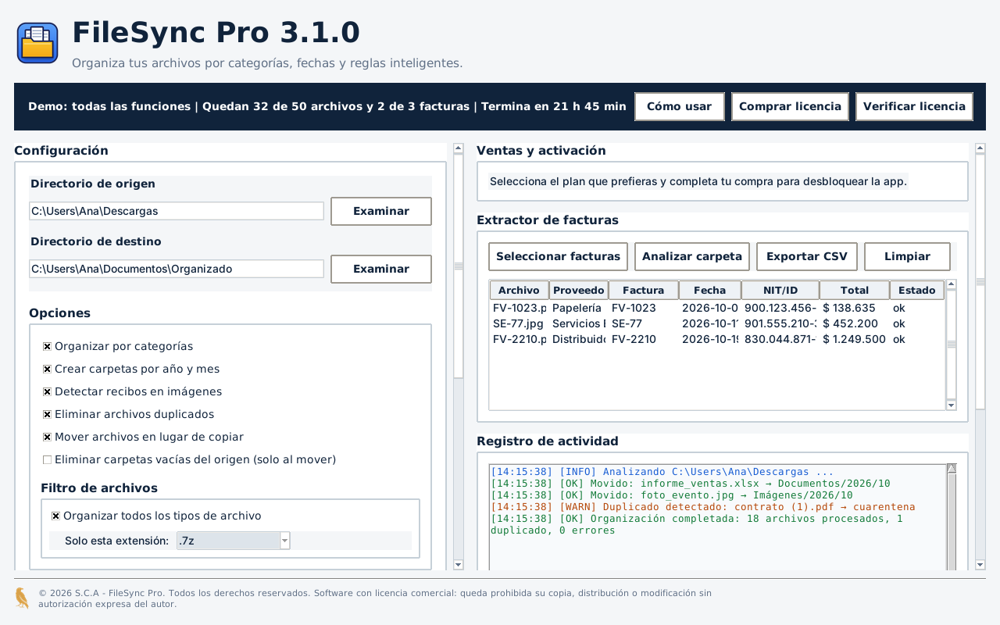
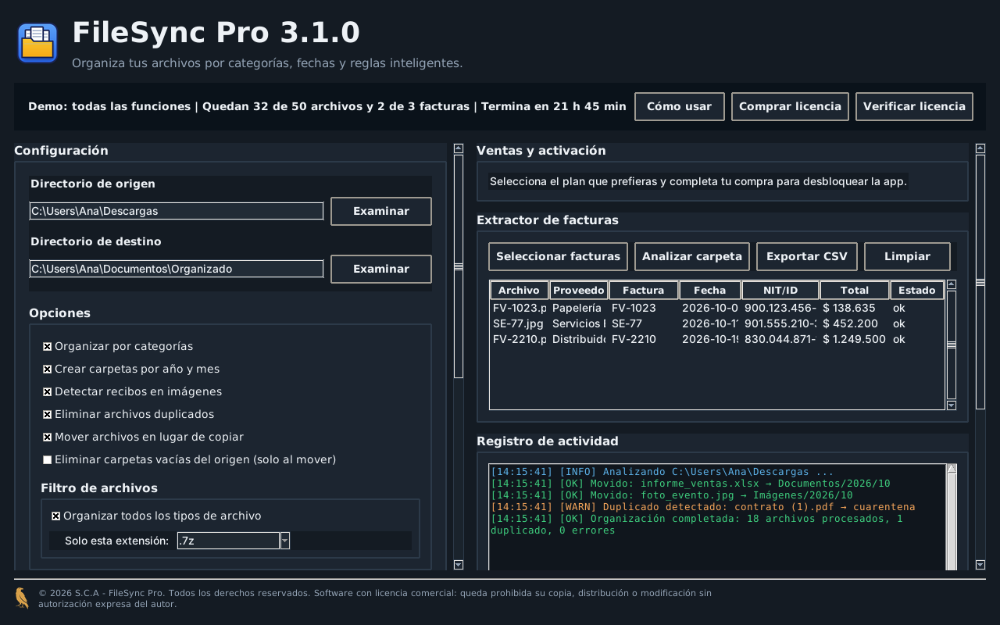

<p align="center">
  
</p>

<h1 align="center">FileSync Pro</h1>

<p align="center">
  Aplicación de escritorio para <b>Windows y macOS</b> (Python + Tkinter) que organiza archivos automáticamente y lee facturas con OCR.<br>
  Pensada para pymes, contadores y freelancers en Colombia. Se vende por suscripción con licencias por plan.<br>
  <a href="https://filesyncpro-n8clbgo.gamma.site/">Sitio web</a>
</p>



## Funciones

- **Organización automática.** Clasifica por categoría (documentos, imágenes, video, audio, código, comprimidos...) y por año y mes. En las fotos usa la fecha EXIF cuando existe. Se puede usar la misma carpeta como origen y destino.
- **Duplicados por contenido.** Compara el hash SHA-256 de cada archivo, no el nombre. Los duplicados no se borran: van a una cuarentena recuperable que se vacía sola a los 30 días.
- **Extractor de facturas.** Lee PDF digitales, PDF escaneados e imágenes (PNG, JPG, TIFF...) y saca proveedor, NIT, número, fecha, subtotal, IVA y total. Exporta a CSV. El motor OCR (Tesseract, español e inglés) viene **dentro** del `.exe` y del `.app`.
- **Operaciones seguras.** Escritura atómica, validación de rutas, cancelar y reanudar una organización a medias, y deshacer la última organización.
- **Opcional:** borra las carpetas que quedan vacías en el origen, aunque nunca borra archivos.
- **Modo oscuro** que se aplica a toda la ventana sin reiniciar y se recuerda.
- **Atajos:** Ctrl/⌘+O (origen), Ctrl/⌘+D (destino), F5 (organizar) y F1 (tutorial guiado).



## Archivos

- `Organizador.py`: la aplicación (interfaz, organizador, extractor de facturas, OCR y licencias).
- `filesync_core/safety.py`: operaciones seguras de archivos (rutas, escritura atómica, cuarentena y purga).
- `filesync_core/platform_compat.py`: diferencias entre Windows y macOS (tipografías, carpeta de datos, identificador de equipo, recorrido de carpetas, ubicación de Tesseract).
- `FileSync Pro.spec`: especificación de PyInstaller, la misma para Windows y macOS.
- `build.ps1`: compila `dist\FileSync Pro.exe` y el instalador en Windows, prepara y adelgaza el Tesseract incluido y, si el `.env` trae un certificado, firma todo.
- `installer/FileSyncPro.iss`: instalador de Windows (Inno Setup).
- `packaging/entitlements.plist`: permisos con los que se firma la app de Mac.
- `build_mac.sh`: compila `FileSync Pro.app`, `.zip` y `.dmg` en macOS.
- `tools/slim_tesseract_win.py`: adelgaza Tesseract para el `.exe`.
- `tools/bundle_tesseract_mac.py`: mete Tesseract dentro del `.app`, con rutas reubicadas y firma.
- `tools/probar_licencias_make.py`: prueba de punta a punta del flujo de licencias (pago simulado, correo, canje y renovación).
- `.github/workflows/build-mac.yml`: compila la versión de Mac en GitHub Actions, para Apple Silicon e Intel.
- `tests/`: pruebas automáticas (`pytest`).
- `assets/`: íconos y logo.
- `backend_app.py`, `render.yaml`, `DEPLOY_FREE.md`: API de licencias en FastAPI de una versión anterior. Ya no se usa: hoy las licencias van por Make.

## Desarrollo

```powershell
Copy-Item .env.example .env      # rellénalo con tus valores reales
pip install -r requirements-desktop.txt
python Organizador.py
```

Pruebas y estilo:

```powershell
pip install pytest ruff
python -m pytest --ignore=tests/test_backend.py
ruff check .
```

El **modo desarrollador** (todas las funciones sin licencia) solo existe al ejecutar desde el código fuente. Se activa con `FILESYNC_PRO_DEV_MODE=1` o poniendo el nombre del equipo en `FILESYNC_PRO_DEV_HOSTNAMES`. Para probar la app como la vería un cliente se usa `FILESYNC_PRO_SIMULATE_CUSTOMER=1`.

Dentro del `.exe` y del `.app` el modo desarrollador está siempre apagado. Además, la app ignora las variables de entorno `FILESYNC_PRO_*` y `WOMPI_*`, los `.env` y los JSON sueltos: **solo cuenta la configuración embebida al compilar**.

Para probar el `.exe` como desarrollador existe `.\build.ps1 -Dev`. Genera `dist_dev\FileSync Pro DEV.exe` con la huella del equipo donde se compila (un hash de su `MachineGuid`) y solo da acceso en ese equipo. Es solo para uso personal: no se distribuye.

## Compilar y distribuir

**Windows:**

```powershell
.\build.ps1
```

`build.ps1` genera `desktop_runtime_config.json` a partir del `.env`, con la URL del servicio de activación, el secreto con que se firman sus respuestas, los links de pago y el plan por defecto. Lo embebe en `dist\FileSync Pro.exe`. Además prepara Tesseract en `vendor\tesseract` y lo adelgaza. Con `-SkipOcr` compila sin OCR y con `-NoSlim` deja Tesseract completo.

Si está instalado [Inno Setup](https://jrsoftware.org/isinfo.php) 6.3 o superior (`winget install JRSoftware.InnoSetup`), también genera el instalador `dist\FileSync-Pro-Setup-<versión>.exe` a partir de `installer/FileSyncPro.iss`. El instalador no pide permisos de administrador, crea los accesos directos y aparece en «Agregar o quitar programas». Al desinstalar no se borran la licencia ni los datos del usuario. Con `-SkipInstaller` se omite. Al terminar muestra el SHA-256 del `.exe` y del instalador.

**macOS:** `bash build_mac.sh` en un Mac, o sin Mac en *Actions > Build macOS > Run workflow*. El flujo arma la configuración desde el secret de Actions `FILESYNC_PRO_RUNTIME_CONFIG`, que contiene el mismo JSON que genera `build.ps1`. Compila las versiones arm64 y x86_64, corre las pruebas y una prueba de humo de la ventana, y comprueba que el OCR incluido funciona después de desinstalar Tesseract del runner. Sin firma de Apple, el primer arranque se aprueba a mano en *Ajustes del Sistema > Privacidad y seguridad > Abrir igualmente*.

Para comprobar el OCR de un ejecutable ya compilado: `--ocr-selftest` (debe terminar en `resultado=OK`).

### Firma de código

Sin firma, Windows muestra «Editor desconocido» y SmartScreen avisa; macOS bloquea la app hasta que el usuario la aprueba en Ajustes. Todo está listo para firmar en cuanto existan los certificados.

**Windows** (certificado de firma de código, por ejemplo Certum Standard Code Signing con SimplySign):

1. Pon el certificado en el `.env` (nunca se empaqueta en el `.exe`):
   - Certificado en el almacén de Windows, token USB o SimplySign (con SimplySign Desktop abierto y la sesión iniciada): `FILESYNC_SIGN_CERT_THUMBPRINT=<huella SHA-1>`. La huella se ve con `Get-ChildItem Cert:\CurrentUser\My -CodeSigningCert`.
   - O un archivo: `FILESYNC_SIGN_PFX=C:\ruta\cert.pfx` y `FILESYNC_SIGN_PFX_PASSWORD=...`.
2. `.\build.ps1` firma solo, con `signtool` (Windows SDK) y sello de tiempo: el Tesseract incluido, el `.exe`, el instalador y el desinstalador. Verifica cada firma. Si el certificado no está disponible, avisa y compila sin firmar.

SmartScreen puede seguir avisando las primeras semanas: la reputación de un certificado nuevo se gana con las descargas.

**macOS** (Apple Developer Program, certificado «Developer ID Application»):

1. Exporta el certificado desde Acceso a Llaveros como `.p12` y crea una contraseña de app en account.apple.com.
2. Agrega estos *secrets* en GitHub: `MACOS_CERT_P12_BASE64` (el `.p12` en base64: `base64 -i certificado.p12`), `MACOS_CERT_PASSWORD`, `APPLE_ID`, `APPLE_TEAM_ID` y `APPLE_APP_PASSWORD`.
3. *Build macOS* firma la app con runtime reforzado (`packaging/entitlements.plist`), firma el `.dmg`, lo notariza con Apple y le «grapa» el resultado. En un Mac propio, `build_mac.sh` hace lo mismo con `FILESYNC_CODESIGN_IDENTITY` y las variables `APPLE_*`.

No distribuyas ni subas a git: `.env`, `desktop_runtime_config.json` ni `desktop_runtime_config.local.json`. Al distribuir, incluye `THIRD_PARTY_NOTICES.md`, con las licencias de Tesseract y otras.

## Licencias y planes

Flujo de compra: la app abre el link de pago de **Wompi** del plan elegido. Wompi avisa a un escenario de **Make**, que verifica la firma del evento, genera un **código de activación aleatorio**, guarda solo su hash y lo envía por correo. El cliente pega el código en «Verificar licencia». La app lo canjea en otro webhook de Make, que liga el código al primer equipo que lo usa y devuelve el plan **firmado**, y la app verifica esa firma. **Un código sirve para un solo equipo.** Cada pago nuevo del mismo correo extiende la licencia 30 días, sin código nuevo.

| Plan | Precio mensual (COP) | Funciones | Usos al mes |
| --- | --- | --- | --- |
| Básica | $18.900 | Organización por categoría y fecha, mover archivos | 3 |
| Pro | $33.900 | + filtro por tipo, duplicados y deshacer | 10 |
| Premium | $59.900 | Todas las funciones | Ilimitados |

**Demo única:** quien no tiene licencia puede probar todas las funciones una vez por equipo, durante 24 horas, hasta 50 archivos y 3 facturas. Lo que se acabe primero. Make registra cada equipo, así que borrar los datos locales no da otra demo. La app guarda una copia del estado en el registro de Windows y detecta si se atrasa el reloj.

Son protecciones contra la manipulación casual, no contra la ingeniería inversa del `.exe`.

## Datos locales

- Windows: `%APPDATA%\FileSync Pro`. La licencia va cifrada con DPAPI.
- macOS: `~/Library/Application Support/FileSync Pro`. El archivo de licencia queda con permisos solo para el usuario.

Ahí están la licencia, `preferencias.json` (modo oscuro y purga automática), la cuarentena de duplicados (`duplicate_quarantine/<fecha>`) y el registro para reanudar o deshacer organizaciones.

## Detalles técnicos destacados

- **De un .exe de 131 MB a uno estimado en 25-45 MB.** PyInstaller copiaba dos veces las DLL de Tesseract y el 95 % de `libtesseract` era información de depuración. `tools/slim_tesseract_win.py` lee las tablas de importación de los PE, borra las DLL que el motor nunca carga y quita las secciones de depuración. La carpeta de Tesseract pasó de 174 MB a 28 MB y lee igual.
- **Mac sin Homebrew.** `tools/bundle_tesseract_mac.py` sigue las dependencias con `otool`, reescribe las rutas con `install_name_tool` y firma cada binario.
- **Licencias estables en Mac.** El identificador del equipo usa el UUID de hardware (`IOPlatformUUID`), porque el nombre de red y la MAC cambian con el Wi-Fi.
- **Pruebas sin interfaz** de la app real con Xvfb, y pruebas de las herramientas de empaquetado con binarios PE sintéticos y un macOS simulado, que corren en cualquier sistema.

## Autor

**Santiago Cuervo Aldana**, de **S.C.A**. Estudiante de Ciencias de la Computación en la Universidad Nacional de Colombia, sede Manizales.

---

© 2026 S.C.A. Todos los derechos reservados. Software con licencia comercial: el código se publica para consulta; queda prohibida su copia, distribución o modificación sin autorización expresa del autor.
